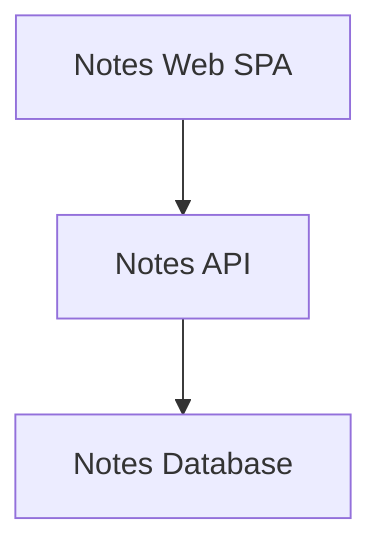
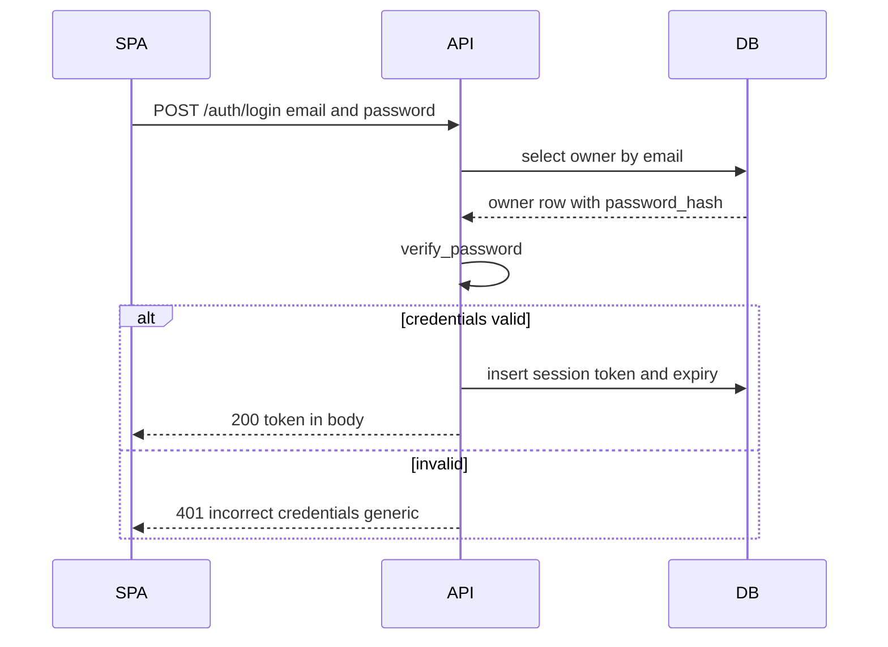
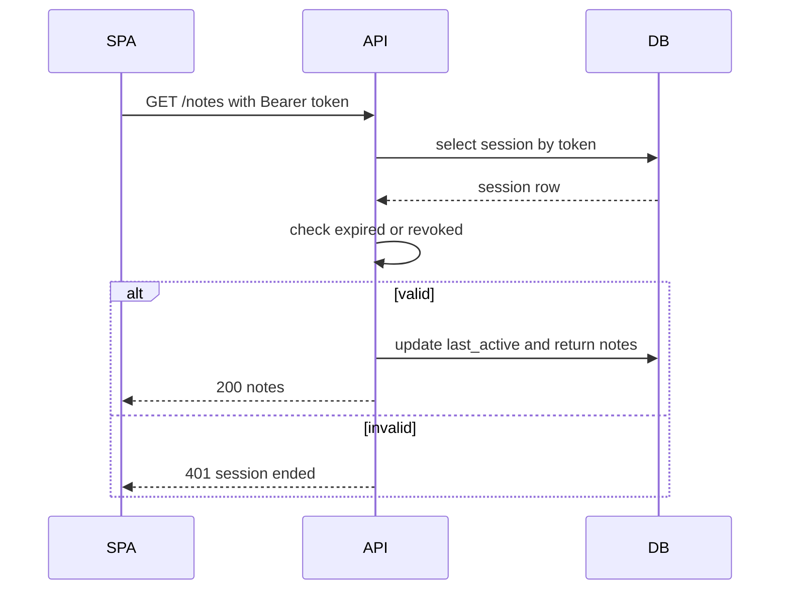
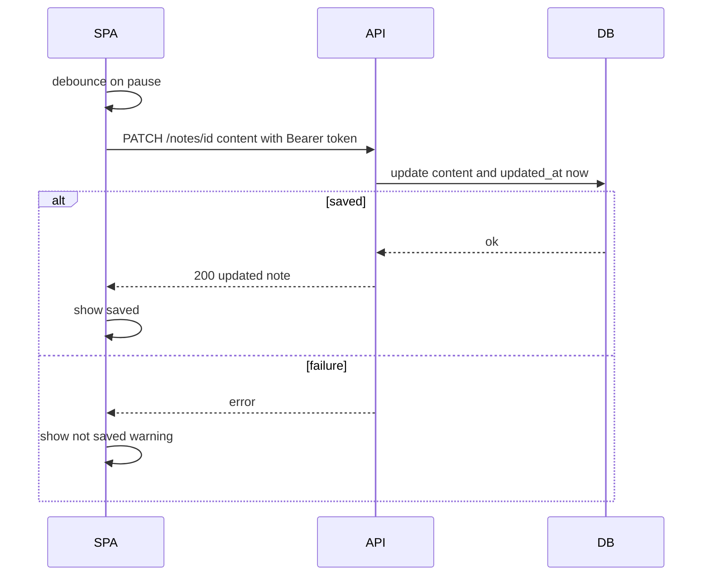
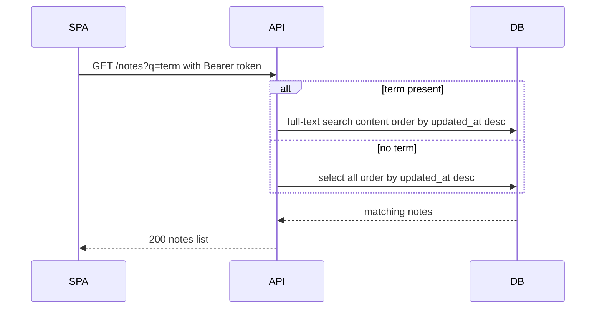
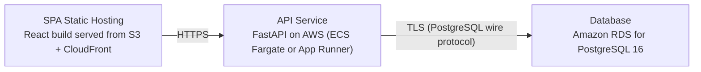

# Architecture

> Maintained by QuorQ AI SDLC. Text between `sdlc:auto` markers is regenerated; anything outside them is yours and is kept.

<!-- sdlc:auto:start narrative -->
## Overview

### ARCH-OVERVIEW · approved · source: architecture:summary

Approved v1 architecture for a lightweight single-owner notes app: React 19 SPA, FastAPI 0.115 backend over HTTPS, PostgreSQL 16 on AWS.

Scope: single owner signs in with email/password; server verifies a hashed password and issues an opaque server-side session token returned in the login response body; SPA stores it and sends `Authorization: Bearer <token>` on every call. Notes are plain text only: create, edit (debounced auto-save), delete, list in one flat list sorted by last activity, and search via PostgreSQL built-in full-text search (no extra search engine). Explicitly out of scope: public registration, billing, rich content.

### ARCH-COMP-SPA · approved · source: architecture:components.spa

Notes Web SPA built with React 19: responsive single page with sign-in screen, notes list, search box, and an auto-saving plain-text editor.

Responsibilities: render sign-in screen, notes list, search box, and debounced auto-saving editor; store the opaque session token client-side and attach it as a Bearer header on every API call.

### ARCH-COMP-API · approved · source: architecture:components.api

Notes API built with FastAPI 0.115: verifies owner credentials, manages opaque session tokens, and serves note CRUD plus search.

Responsibilities: verify the single owner's credentials; mint and revoke opaque session tokens; enforce session expiry; provide create/view/edit/delete/list/search operations over the owner's plain-text notes.

### ARCH-COMP-DB · approved · source: architecture:components.db

Notes Database on PostgreSQL 16: stores the owner account, active sessions, and notes.

Stores the owner account (with hashed password), active sessions, and notes with created/updated timestamps. Serves recent-activity ordering (updated_at) and full-text search (tsvector + GIN).

### ARCH-FLOW-LOGIN · approved · source: architecture:critical_paths.owner_sign_in

Owner sign-in and session issue flow: credential verification followed by opaque session token creation.

Owner submits email and password; API fetches the single owner row and verifies the password hash. On success it creates a session row with an opaque token and expiry, returning the token in the response body. On failure it returns a generic message that does not reveal which field was wrong, per NFR-003.

**Related:** NFR-003

### ARCH-FLOW-AUTH · approved · source: architecture:critical_paths.authenticated_request

Authenticated request flow: every protected call is validated against an active, non-expired session before being served.

Every protected call carries `Authorization: Bearer <token>`. The API looks up the session and rejects it if missing, revoked, or past its inactivity expiry; otherwise it slides the expiry forward before serving the request, per NFR-002.

**Related:** NFR-002

### ARCH-FLOW-AUTOSAVE · approved · source: architecture:critical_paths.edit_note_autosave

Edit note with auto-save flow: debounced keystrokes trigger background saves, with failure surfaced to the owner.

The editor debounces keystrokes and, on a pause, sends the updated text; the API updates the note and sets updated_at to the change time. If the save request fails, the SPA surfaces an unsaved-change indicator so no edit is silently lost, per NFR-006.

**Related:** NFR-006

### ARCH-FLOW-SEARCH · approved · source: architecture:critical_paths.list_and_search

List and search notes flow: notes list ordered by recent activity, optionally filtered by full-text search.

The list is returned ordered by updated_at descending. When a search term is present, the API runs a PostgreSQL full-text query against the note content, returning only matching notes, still ordered by recent activity.

### ARCH-DATA-MODEL · approved · source: architecture:entities

Data model covers three entities: owner, session, and note.

owner: id, email, password_hash, created_at. session: token, owner_id, created_at, last_active_at, expires_at, revoked_at. note: id, owner_id, content, content_tsv, created_at, updated_at.

### ARCH-API-ENDPOINTS · approved · source: architecture:endpoints

Eight REST endpoints cover authentication (login, logout, session check) and note CRUD plus search.

POST /auth/login - verify email/password, create a session on success and return its opaque token in the body, or a generic credentials-incorrect message on failure. POST /auth/logout - revoke the current session token. GET /auth/me - return the signed-in owner for session validation on app load. GET /notes - list the owner's notes ordered by most recent activity; with query param q, return only full-text matches. POST /notes - create a new plain-text note with a created timestamp. GET /notes/{id} - return the full content of a single note. PATCH /notes/{id} - update a note's text (used by auto-save) and set updated_at. DELETE /notes/{id} - permanently delete a note.

### ARCH-DEPLOY-SPA · approved · source: architecture:deployment_nodes.spa_hosting

SPA is deployed as a static React build served from S3 + CloudFront.

Deployment node: SPA Static Hosting, static assets, built with Vite and configured via VITE_API_BASE_URL at deploy time.

### ARCH-DEPLOY-API · approved · source: architecture:deployment_nodes.api_service

API runs as a containerized FastAPI service on AWS.

Deployment node: API Service, FastAPI on AWS (ECS Fargate or App Runner), Python 3.12 / Uvicorn.

### ARCH-DEPLOY-DB · approved · source: architecture:deployment_nodes.database

Database runs as a managed Amazon RDS PostgreSQL 16 instance.

Deployment node: Database, Amazon RDS for PostgreSQL 16, managed PostgreSQL 16.

### ARCH-TECH-FRONTEND · approved · source: architecture:technology_decisions.frontend

Frontend chosen: React 19 (alternatives considered: Vue, Svelte).

Drives the single responsive page (notes list, search box, debounced auto-saving editor) updating without reloads, and stores the opaque session token to send as a Bearer header. Built with Vite; reads VITE_API_BASE_URL at deploy.

### ARCH-TECH-BACKEND · approved · source: architecture:technology_decisions.backend

Backend chosen: FastAPI 0.115 (alternatives considered: Flask, Django REST Framework).

Small, typed Python service handling login, opaque session issue/revoke, and note CRUD plus full-text search with minimal code, maintainable by one person.

### ARCH-TECH-DB · approved · source: architecture:technology_decisions.database

Database chosen: PostgreSQL 16 (alternatives considered: MySQL, SQLite).

Stores owner, sessions, and notes reliably; built-in full-text search (tsvector + GIN) backs the search box, and updated_at indexing gives recent-activity ordering — no extra search engine needed.

### ARCH-TECH-CLOUD · approved · source: architecture:technology_decisions.cloud

Cloud provider chosen: AWS (alternatives considered: GCP, Azure).

Hosts the FastAPI service and managed RDS PostgreSQL with automated backups and encryption at rest/in transit, keeping notes available from any browser the owner signs in from.
<!-- sdlc:auto:end narrative -->

<!-- sdlc:auto:start building-blocks -->
## Building Block View

| ID | Name | Technology | Responsibility | Depends on |
|---|---|---|---|---|
| spa | Notes Web SPA | React 19 | Responsive single-page app: sign-in screen, notes list, search box, and auto-saving plain-text editor. Stores the session token and sends it as a Bearer header on every API call. | api |
| api | Notes API | FastAPI 0.115 | Verifies the single owner's credentials, mints and revokes opaque session tokens, enforces session expiry, and provides create/view/edit/delete/list/search of the owner's plain-text notes. | db |
| db | Notes Database | PostgreSQL 16 | Stores the owner account (with hashed password), active sessions, and notes with created/updated timestamps. Serves recent-activity ordering and full-text search. | — |

<!-- sdlc:auto:end building-blocks -->

<!-- sdlc:auto:start runtime -->
## Runtime View

### Owner sign-in and session issue

Owner submits email and password; API fetches the single owner row, verifies the password hash, and on success creates a session row with an opaque token and expiry, returning the token in the response body. On failure it returns a generic message that does not reveal which field was wrong (NFR-003).

- **Components:** spa, api, db
- **Modules:** auth_router, security, session_store
- **Key functions:** login(email, password), verify_password(plain, hash), create_session(owner_id) -> token, generic_auth_error()

### Authenticated request with session check

Every protected call carries Authorization: Bearer <token>. The API looks up the session, rejects it if missing, revoked, or past its inactivity expiry, and otherwise slides the expiry forward before serving the request (NFR-002).

- **Components:** spa, api, db
- **Modules:** deps, session_store
- **Key functions:** get_current_owner(token), touch_session(token), is_expired(session)

### Edit note with auto-save

The editor debounces keystrokes and on pause sends the updated text; the API updates the note and sets updated_at to the change time. If the request fails the SPA surfaces an unsaved-change indicator so no edit is silently lost (NFR-006).

- **Components:** spa, api, db
- **Modules:** notes_router, note_repository, editor_autosave
- **Key functions:** update_note(note_id, content), debounce(fn, delay), showUnsavedState()

### List and search notes

The list is returned ordered by updated_at descending. When a search term is present the API runs a PostgreSQL full-text query against the note content, returning only matches, still ordered by recent activity.

- **Components:** spa, api, db
- **Modules:** notes_router, note_repository
- **Key functions:** list_notes(owner_id, query), search_fulltext(owner_id, term)

<!-- sdlc:auto:end runtime -->

<!-- sdlc:auto:start deployment-view -->
## Deployment View

| Name | Service | Runtime | Scaling | Environment |
|---|---|---|---|---|
| SPA Static Hosting | React build served from S3 + CloudFront | Static assets | CDN edge | dev |
| API Service | FastAPI on AWS (ECS Fargate or App Runner) | Python 3.12 / Uvicorn | 1 small task (single-owner load) | dev |
| Database | Amazon RDS for PostgreSQL 16 | PostgreSQL 16 managed | single instance with automated backups | dev |

| Source | Target | Protocol |
|---|---|---|
| SPA Static Hosting | API Service | HTTPS |
| API Service | Database | TLS (PostgreSQL wire protocol) |

<!-- sdlc:auto:end deployment-view -->

<!-- sdlc:auto:start decisions -->
## Architecture Decisions

| Layer | Choice | ADR |
|---|---|---|
| Frontend | React 19 | [ADR-0001](adr/frontend.md) |
| Backend | FastAPI 0.115 | [ADR-0002](adr/backend.md) |
| Database | PostgreSQL 16 | [ADR-0003](adr/database.md) |
| Cloud | AWS | [ADR-0004](adr/cloud.md) |
<!-- sdlc:auto:end decisions -->

<!-- sdlc:auto:start links -->
## Related Documents

- [Data Model](data-model.md)
- [API Specification](api/openapi.yaml)
- [Architecture Decision Records](adr/README.md)
<!-- sdlc:auto:end links -->
