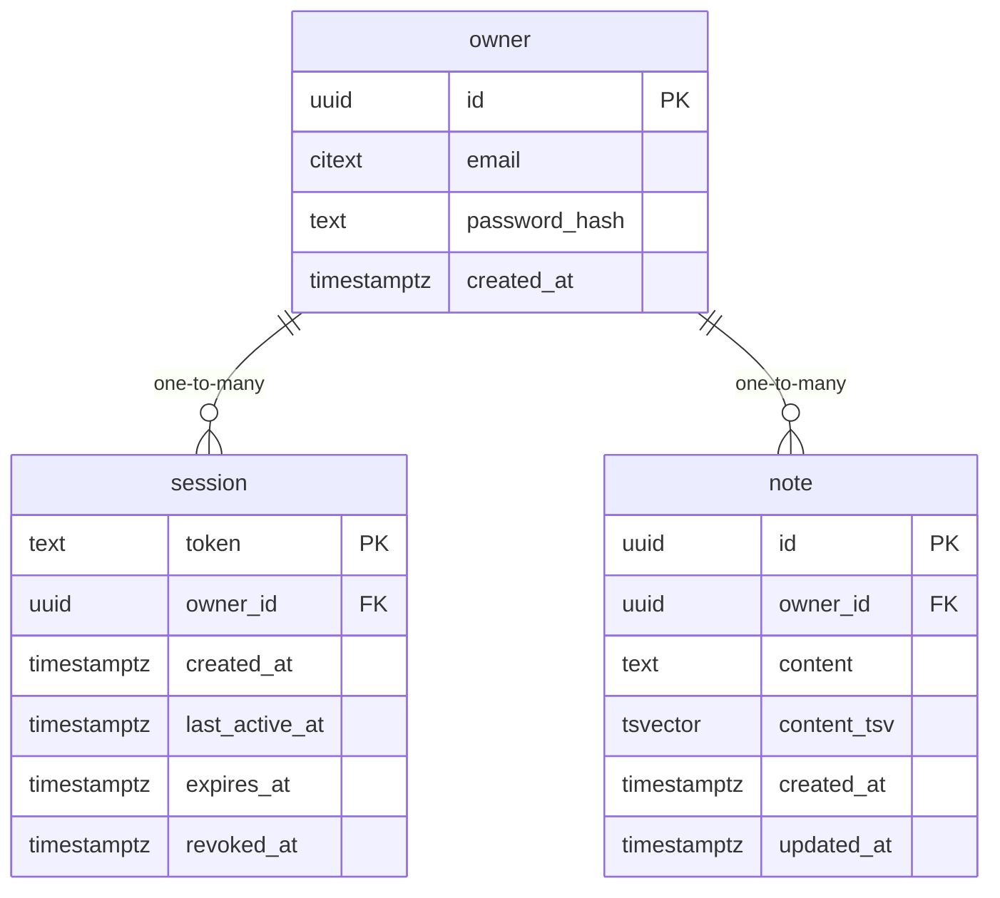

# Data Model

<!-- sdlc:auto:start entities -->
### owner

| Field | Type | PK | FK | Nullable |
|---|---|---|---|---|
| id | uuid | True | — | False |
| email | citext | False | — | False |
| password_hash | text | False | — | False |
| created_at | timestamptz | False | — | False |

### session

| Field | Type | PK | FK | Nullable |
|---|---|---|---|---|
| token | text | True | — | False |
| owner_id | uuid | False | owner.id | False |
| created_at | timestamptz | False | — | False |
| last_active_at | timestamptz | False | — | False |
| expires_at | timestamptz | False | — | False |
| revoked_at | timestamptz | False | — | True |

### note

| Field | Type | PK | FK | Nullable |
|---|---|---|---|---|
| id | uuid | True | — | False |
| owner_id | uuid | False | owner.id | False |
| content | text | False | — | False |
| content_tsv | tsvector | False | — | True |
| created_at | timestamptz | False | — | False |
| updated_at | timestamptz | False | — | False |
<!-- sdlc:auto:end entities -->

<!-- sdlc:auto:start relationships -->
| Source | Target | Type |
|---|---|---|
| owner | session | one-to-many |
| owner | note | one-to-many |
<!-- sdlc:auto:end relationships -->

<!-- sdlc:auto:start er-diagram -->

<!-- sdlc:auto:end er-diagram -->
